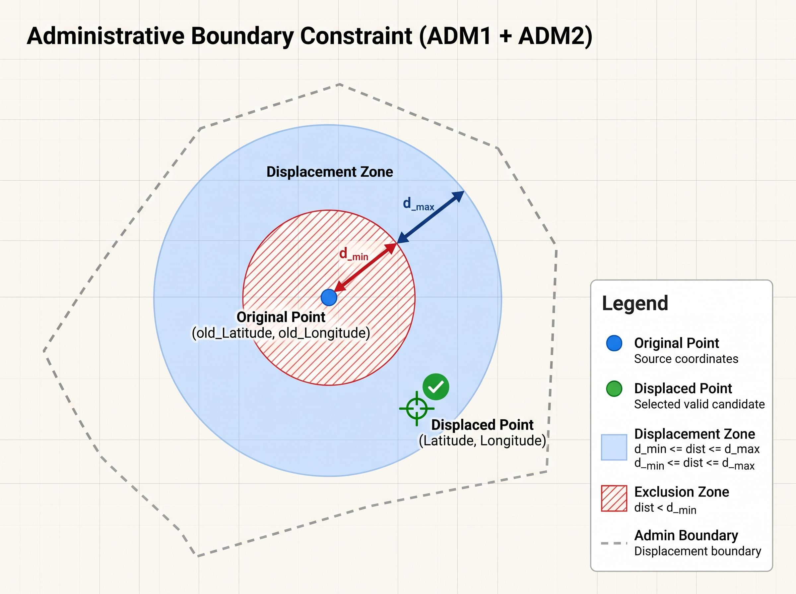
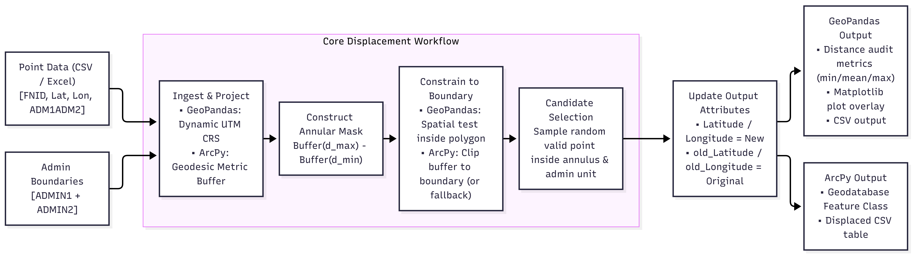
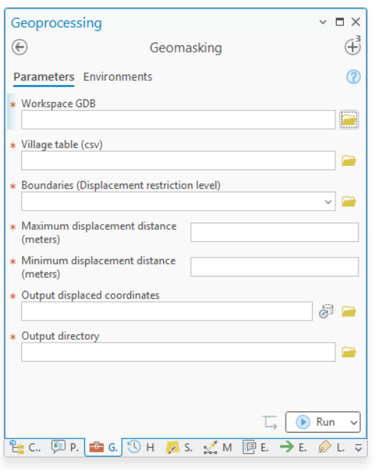

# FEWS NET Geomasking Tool Documentation

This repository provides reproducible spatial anonymization (geomasking) for survey and village point datasets. It includes a standalone open-source implementation built on **GeoPandas** and an enterprise GIS implementation built for **ArcGIS Pro** using **ArcPy** and Python Toolbox (`.pyt`) interfaces.

---

## 1. System Overview & Methodology

Geomasking displaces sensitive point coordinates (such as household or settlement locations) to prevent direct spatial identification while preserving statistical and spatial aggregate utility.

### The Annular Constrained Displacement Algorithm

Both implementations enforce two spatial invariants:
1. **Distance Bounds ($[d_{\min}, d_{\max}]$):** Every displaced point lies within an annular ring (donut buffer) defined by an inner radius $d_{\min}$ and an outer radius $d_{\max}$ centered on the original coordinate.
2. **Administrative Boundary Restriction:** The displaced location cannot cross the parent administrative unit (e.g., concatenated `ADMIN1` + `ADMIN2`).



---

## 2. Architecture & File Structure

| File | Framework | Primary Purpose | Key Dependencies |
| :--- | :--- | :--- | :--- |
| `geomasking.py` | Open-Source GIS | Standalone CLI displacement, diagnostic plotting, and metrics reporting. | `geopandas`, `pandas`, `matplotlib`, `shapely` |
| `geomasking_arcgis.py` | Esri ArcPy Core | Spatial processing engine: Geodesic annular buffers, boundary clipping, and random candidate sampling. | `arcpy`, `pandas` |
| `Toolbox.pyt` | ArcGIS Python Toolbox | UI parameter validation, error trapping, progress reporting, and workflow orchestration. | `arcpy`, `pandas` |

---



## 3. Implementation Details

### Implementation A: Standalone Open-Source (`geomasking.py`)

* **Coordinate Operations:** Ingests coordinates in WGS84 (`EPSG:4326`) and converts them dynamically to an estimated local UTM coordinate reference system (`gdf.estimate_utm_crs()`) to execute meter-based planar buffers.
* **Annular Mask Creation:** Constructs `point.buffer(max_dist).difference(point.buffer(min_dist))`.
* **Sampling & Verification:** Samples 100 candidate points across the annular polygon via `GeoSeries.sample_points(100)`. Each candidate is tested against the corresponding administrative boundary polygon via `.contains()`. One valid candidate is chosen uniformly at random.
* **Diagnostics & Auditing:** The `get_displacement_distance()` function calculates the exact Euclidean displacement achieved per record. `get_report()` summarizes maximum, minimum, and mean displacement and renders a Matplotlib comparative overlay.

### Implementation B: ArcGIS Pro Pipeline (`Toolbox.pyt` + `geomasking_arcgis.py`)

* **Schema Stability:** Uses `arcpy.da.InsertCursor` during feature class ingestion rather than `XYTableToPoint` to avoid locking anomalies or implicit field truncation in enterprise geodatabases.
* **True Geodesic Annuli:** Employs `arcpy.analysis.Buffer` with `method="GEODESIC"`. This maintains accurate metric distances even when inputs remain in geographic coordinate systems (latitude/longitude degrees).
* **Annulus Generation:** Executes `arcpy.analysis.SymDiff` between the outer geodesic buffer and the inner buffer.
* **Boundary Clipping & Resilient Fallback:** Clips the annulus against the target boundary via `arcpy.analysis.Clip`. If the annulus falls outside the boundary (such as on narrow administrative corners or coastal margins), the tool issues a warning and constrains candidates within the boundary feature directly.
* **Sampling:** Generates points using `arcpy.management.CreateRandomPoints(..., number_of_points_or_field=50)` and assigns an arbitrary point using an OID query filter.
* **UI Validation:** The `.pyt` wrapper enforces that $d_{\max} > d_{\min}$ via `updateMessages()` prior to execution.

---

## 4. Input Data Specifications

### 1. Village Table (`.csv` or `.xlsx`)

The input table must provide point geometry and boundary join attributes:

| Field Name | Type | Description |
| :--- | :--- | :--- |
| `FNID` | String / ID | Unique feature or cluster identifier (required by ArcGIS module). |
| `Latitude` | Float | Original latitude coordinate in decimal degrees (WGS84 / `EPSG:4326`). |
| `Longitude` | Float | Original longitude coordinate in decimal degrees (WGS84 / `EPSG:4326`). |
| `ADM1ADM2` | String | Concatenated administrative boundary join key (e.g., `"NorthDistrictA"`). |

### 2. Administrative Boundaries

* **Vector Format:** Shapefile (`.shp`), GeoJSON, or File Geodatabase Feature Class.
* **Required Attributes:** Must contain individual administrative fields (defaults: `ADMIN1` and `ADMIN2`) or a pre-computed composite field named `ADM1ADM2`.

---

## 5. Execution Guide

### Option 1: Running the Open-Source CLI

```bash
python geomasking.py
```

The interactive terminal will prompt for the required arguments:
1. **Village data path:** Path to source `.csv` or `.xlsx`.
2. **Boundary path:** Vector boundary file.
3. **Maximum displacement distance:** Integer (meters).
4. **Minimum displacement distance:** Integer (meters).
5. **Output directory & filename:** Destination path for the anonymized CSV.

### Option 2: Running via ArcGIS Pro Python Toolbox

1. Open **ArcGIS Pro**.
2. Open the **Catalog Pane**, expand **Toolboxes**, and add `Toolbox.pyt`.
3. Open the **Geomasking** tool.
4. Fill in the parameters:
   * **Workspace GDB:** Target File Geodatabase for scratch operations.
   * **Village table (csv):** Path to input CSV.
   * **Boundaries:** Boundary layer or feature class.
   * **Maximum displacement distance (meters):** e.g., `5000`.
   * **Minimum displacement distance (meters):** e.g., `1000`.
   * **Output displaced coordinates:** Output geodatabase feature class name.
   * **Output directory:** Folder where `Displacement_output.csv` will be written.
5. Click **Run**.



---

## 6. Output Schemas

Both workflows retain original coordinates for auditing while replacing active spatial columns with masked values:

* `Latitude`, `Longitude`: Newly displaced spatial coordinates.
* `old_Latitude`, `old_Longitude`: Preserved original coordinates.
* `Displacement distance`: Calculated displacement distance in meters (generated in `geomasking.py`).
* `FNID`, `ADM1ADM2`: Original join keys and administrative linkages.